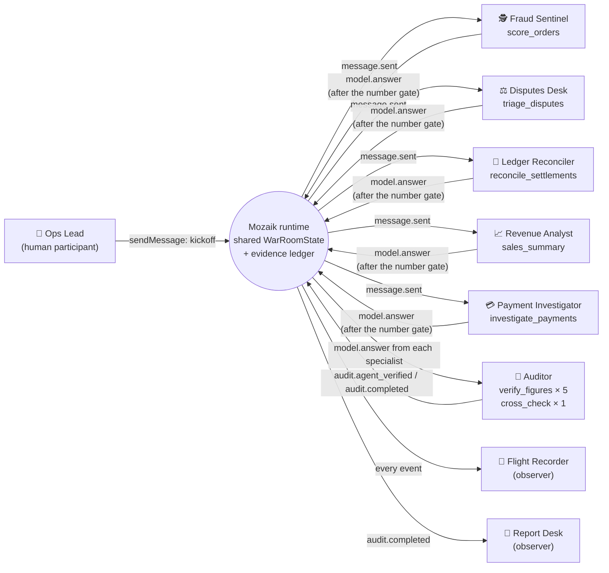

# 🛒 Black Friday War Room

**Six Mozaik agents close out a store's Black Friday. Five specialists run at the same time; an Auditor recomputes every number they report from the raw CSV rows.**

Built for the JigJoy Black Friday AI Hackathon (Agents in Finance track) on `@mozaik-ai/core` 6.0.0.

> **Not financial advice.** All data is synthetic: a fixed seed and a fictional store, "Lumen & Loom". No real customers, accounts or money are involved. Refund, chargeback and claim decisions are drafts for a person to review. Nothing in this project moves money.

- Sample report (offline, deterministic, current code): [`docs/sample-offline/report.md`](docs/sample-offline/report.md) · hosted at **https://bf-war-room.vercel.app** (redirects to `sample-offline/report.html`)
- Sample report (live MiniMax run, 2026-11-27, five specialists): [`docs/sample-live/report.html`](docs/sample-live/report.html) · https://bf-war-room.vercel.app/sample-live/report.html. This run was made just before the number-gate fix described under "Built during the hackathon", so its Auditor cross-check summary shows the gate wrongly flagging "11".

## The problem

The Monday after Black Friday, a small online shop has five piles of work and nobody to do them:

1. **Fraud.** Which orders that already went through should not ship? Was there a card-testing attack?
2. **Disputes.** Refund requests and chargebacks are piling up. Which ones do we approve, which do we fight, and which are due this week?
3. **Settlement.** The payment processor paid out less than expected. Where did the money go, to the cent?
4. **Revenue.** What did the day actually bring in after discounts, refunds and chargebacks?
5. **Failed and stuck payments.** Dozens of checkouts failed or are still pending. Which ones should we retry, which customers do we contact, which need a person to look at them, and did anyone get charged twice?

Each pile needs a different specialist, and the owner has to be able to trust the numbers. So every figure in the report points to the CSV lines it came from, and a separate agent checks each one before the report is written.

## Run it (about 1 minute)

Requires Node.js 20.11 or newer.

```bash
git clone https://github.com/qinheyi/bf-war-room.git
cd bf-war-room
npm install
npm start          # no API key? runs in deterministic offline mode
npm test           # 17 tests, including a full offline war-room run
```

Open `reports/report.html` in a browser (`reports/report.md` has the same content). The command exits with code 0 only if every figure was verified and every cross-agent check passed.

| Mode | How | What thinks |
|---|---|---|
| Offline (default with no key) | `npm start` or `npm run demo` | A deterministic policy model running inside Mozaik: it calls the agent's tool, then writes the summary from the tool output. Same Mozaik loops, events and interception. No network. |
| MiniMax | `MINIMAX_API_KEY=... npm start` (optional `MINIMAX_MODEL`, default `MiniMax-M3.1-Flash`; `MINIMAX_BASE_URL`, default `https://api.minimaxi.com/v1`) | MiniMax's OpenAI-compatible chat API through Mozaik's `OpenAIChatCompletions` endpoint. One run makes about 22 small calls. |
| OpenAI | `OPENAI_API_KEY=... npm start -- --provider openai` (optional `OPENAI_MODEL`, default `gpt-4.1-mini`) | Same, against OpenAI. |

In every mode the numbers come from deterministic tools, never from the model. If a live model call fails or breaks the protocol, that one step falls back to the offline policy and the report counts the fallback.

Other commands: `npm run generate-data` rebuilds `data/*.csv` from the seed (byte-identical), and `npm run typecheck` runs the TypeScript checks.

## Architecture: how the agents run at the same time

Everything runs in one Mozaik runtime (`defineRuntime` → `initializeRuntime`). Participants join it, and the runtime fans every event out to all of them. Nothing is called in a fixed order. Each participant reacts to events through its own situation handlers.



1. **Kickoff.** The Ops Lead (a `createHuman` participant) sends one message.
2. **Five specialist agents start at the same moment.** Each one (`createAgent`) has a situation handler that matches the Ops Lead's `message.sent` and calls `runLoop(...)`. `runLoop` does not block, so the five loops run concurrently. Each loop is a full Mozaik state machine: `message_received → inference → function_call → inference → model_message`.
3. **The number gate (interception).** Every specialist loop gets an `InterceptionHandler`. At the `function_call` breakpoint it logs the tool and allows only that agent's read-only tool. At the `model_message` breakpoint it pulls every number out of the agent's prose and checks it against that agent's evidence. Any number it can't trace is rewritten as `⟦unverified: …⟧` before the answer is published.
4. **The Auditor checks each agent as soon as it answers.** Its handler matches `model.answer` from a specialist and starts a new verification loop right away, while the other specialists are still working. Its `verify_figures` tool re-reads the raw CSV text and re-runs each figure's recipe on the exact cited lines.
5. **Cross-check.** When all five are verified (the custom `audit.agent_verified` events), the Auditor starts one more loop. `cross_check` compares the agents with each other: Revenue vs Ledger on captured sales, Fraud vs Disputes on how many fraud chargebacks the rules would have caught, whether the payout variance is fully explained, and five checks on the Payment Investigator (C7–C11, below). Then it publishes `audit.completed`.
6. **Observers.** The Flight Recorder logs every event with a timestamp. That log becomes the concurrency timeline in the report. The Report Desk waits for `audit.completed`.

**Shared state.** `WarRoomState extends RuntimeState` holds the dataset, the evidence ledger, each agent's results, the gate log and the trace. The agents never pass numbers to each other in text. They write figures to the ledger, and the Auditor reads the ledger and the raw files.

A typical offline trace (from `npm start`, times in ms):

```text
Fraud Sentinel                           ███████████████████                                    2–553   ms
Disputes Desk                            ████████████████████                                   2–556   ms
Ledger Reconciler                        █████████████████████                                  2–595   ms
Revenue Analyst                          ███████████████████████                                2–647   ms
Payment Investigator                     █████████████████                                      2–489   ms
Auditor (verify Payment Investigator)                     ████████████████████████████        489–1284  ms
Auditor (verify Fraud Sentinel)                             ███████████████████████████       553–1303  ms
Auditor (verify Disputes Desk)                               ██████████████████████████       556–1304  ms
Auditor (verify Ledger Reconciler)                            ███████████████████████████     596–1360  ms
Auditor (verify Revenue Analyst)                                ██████████████████████████    647–1403  ms
Auditor (cross-check)                                                       ███████████████   991–1425  ms
```

That is eleven agent loops, with up to six running at once. In the live MiniMax run the loops take 2–8 seconds each and overlap the same way (see `docs/sample-live/trace.json`).

## Payment Investigator (built during the hackathon)

The fifth specialist reads `data/payment_exceptions.csv`: 72 payment attempts that failed or are still pending. The file has raw signals only (`status`, `response_code`, `three_ds`, `gateway_http`, `risk_decision`). The cause isn't in the CSV, so the agent works it out with the `PI-*` rules in `data/POLICY.md`, applied in order:

| Rule | Signal | Cause | Recommended action |
|---|---|---|---|
| PI-DUP | approval code `00` on an order that `orders.csv` already shows as captured | duplicate charge | refund: void the duplicate authorisation |
| PI-RISK | `risk_decision = block` | risk-engine block | manual review, never auto-retry |
| PI-GW | `gateway_http` 5xx | gateway error | retry once with the same idempotency key |
| PI-3DS | pending with `three_ds = challenge_sent` | 3-D Secure timeout | retry: send a fresh payment link |
| PI-NSF | code `51` | insufficient funds | contact the customer, don't retry |
| PI-ISSUER | any other failed issuer code | issuer decline | contact the customer, ask for another method |

It registers 20 figures (`P1`–`P20`): counts and amounts per cause, the 23 retries worth $2,279.03 (`P17`, `P18`), and the 5 duplicate authorisations worth $408.85 (`P15`, `P16`). Every case is listed in the report with its signals, rule, action and source line. The Auditor checks this agent in two ways:

- **Independent re-classification.** Each per-cause figure uses a `cause` recipe. The Auditor re-reads every row of the raw CSV, classifies it with its own rule table in `src/audit.ts` (separate code from `src/analytics/payments.ts`), and requires the cited lines to match its set exactly before it counts or sums them. If a risk block is filed as a retryable gateway error, both figures fail (a test does exactly this).
- **Cross-checks against the other desks.** C7: there is exactly one non-duplicate exception for every order the Revenue Analyst counted as declined (`P1 − P15 = R3`). C8: no failed or pending payment appears in the payout the Ledger Reconciler matched. C9: every duplicate authorisation is on a captured, settled order and equals its charge, so the refund is safe. C10: no retry is recommended on an order the Fraud Sentinel flagged (score 50+). C11: every exception got a cause (`P20 = 0`).

## Every number has a source

- **Evidence ledger** (`src/evidence.ts`). Every figure is registered with an ID (`F4`, `L7`, …), a plain-English recipe, the policy rules it depends on, and a recipe the Auditor can re-run. A recipe is one of: `count`/`sum` over exact CSV line numbers, `expectedFees` from `fee_schedule.csv`, `netDiff` between settlement and order lines, a `lookup` of one cell, or `derived` arithmetic over other evidence IDs.
- **Independent recompute** (`src/audit.ts`). This is separate code from the analytics. It reads the raw file text, fetches each cited line, applies the recipe, and compares the result to the reported value to the cent. Derived figures are rebuilt from recomputed inputs, never from reported values. A cited line that doesn't exist fails the check.
- **Number gate.** Numbers in model-written prose must match a figure the agent registered. Dates, clock times, IDs and rule codes are ignored. Small counting words (0–10) are allowed.
- **Policy as data.** `data/POLICY.md` defines the fraud scoring rules, refund and chargeback rules (with rule IDs the report cites) and the fee formula.
- **Rendering.** The report shows each figure next to its evidence ID, recipe, source lines and audit result. `reports/evidence.json` lists every source line.

## Data

All files are in `data/`. They are synthetic and generated by `scripts/generate-data.ts` (seed `20261127`). Line numbers count the header as line 1.

| File | Rows | What it is |
|---|---|---|
| `orders.csv` | 1,226 | Black Friday orders: amounts, discounts, AVS/CVV results, countries, device, captured or declined |
| `disputes.csv` | 83 | Refund requests and chargebacks (Visa-style reason codes 10.4, 13.1, 13.3), deadlines, tracking status |
| `settlements.csv` | 1,151 | The processor's payout report, one line per captured order (with planted defects) |
| `fee_schedule.csv` | 3 | Contract fees: card 2.9% + $0.30, wallet 2.5% + $0.30, chargeback $15 |
| `payment_exceptions.csv` | 72 | Failed or pending payment attempts with raw signals only (status, response code, 3DS state, gateway HTTP status, risk decision). Added during the hackathon; generated from its own RNG stream (seed + 1) so the other files are unchanged |
| `POLICY.md` | n/a | The rules the agents apply |
| `planted_defects.json` | n/a | Ground truth for the planted problems. **Only the tests read it**; the agents never do. |

Planted problems include a 26-order card-testing burst from one device, 12 captured orders missing from the payout, 4 orders paid out twice, 8 fee overcharges, 6 short settlements, and a true cause for each of the 72 payment exceptions (including 5 duplicate authorisations). The tests check that the agents find all of them and that the payout variance is explained to $0.00.

## Project layout

```text
src/warroom.ts           Mozaik runtime, participants, situation handlers, number-gate interception
src/models.ts            offline policy endpoint, MiniMax/OpenAI endpoints with fallback
src/analytics/*.ts       deterministic tools: fraud, disputes, reconcile, revenue, payments, cross-checks
src/audit.ts             independent recompute, expression evaluator, number gate
src/evidence.ts          evidence ledger
src/report.ts, cli.ts    Markdown + HTML report, one-command entry point
test/*.test.ts           node:test suite (data, policy, reconciliation, payments, audit tampering, full run)
```

## Built during the hackathon

The hackathon kicked off on 2026-11-26 at 10:00 CET (17:00 Beijing). To be clear about what came before and after:

**Prepared before kickoff** (commits `2deaf95`, `5d6c17f`, `3e38613`, all on 2026-11-26 between 08:42 and 08:46 Beijing time, before the 17:00 kickoff): the core framework and the first four specialists. That covers the Mozaik 6.0.0 runtime and participants, the Fraud Sentinel, Disputes Desk, Ledger Reconciler and Revenue Analyst, the Auditor with `verify_figures` and cross-checks C1–C6, the evidence ledger, the number gate, the offline and MiniMax/OpenAI model wiring, the report, the synthetic orders/disputes/settlements data, 11 tests, and the Vercel static page.

**Built during the hackathon** (2026-11-27, after kickoff):

| Commit | What |
|---|---|
| `9fc06c1` | Synthetic failed/pending payments dataset `payment_exceptions.csv` (72 rows, its own RNG stream so the original CSVs are byte-identical) and the `PI-*` rules in `POLICY.md` |
| `e803166` | **Payment Investigator**, a fifth specialist that runs concurrently with the other four (`investigate_payments`, figures P1–P20). The Auditor's new `cause` recipe re-classifies every raw row independently. Five new cross-agent checks (C7–C11). Number-gate fix: it now rewrites whole numeric tokens only, and the Auditor may quote cross-check tallies. The first five-agent live MiniMax run showed a flagged "11" corrupting "$112,507.58". Report section and "do this today" action. |
| `c7a8d1a` | 6 new tests (17 in total): planted causes recovered, rule precedence, independent recompute of P1–P20, a mislabelled-payment tamper test, cross-checks incl. a C10 tamper test, and a gate regression test |
| this commit | README, SUBMISSION.md, regenerated sample reports (offline and a live MiniMax run), Vercel landing page |

Result after these changes: 11 agent loops (5 specialists overlapping, up to 6 at once), 76 of 76 figures recomputed from raw rows, 11 of 11 cross-agent checks, 17 of 17 tests.

## Limits

- The fraud rules are a simple, transparent points system, not a trained model. In this dataset they would have flagged 53.8% of the later fraud chargebacks (figure `A3` in the report).
- The decisions are drafts. Nothing here calls a payment API: retries, refunds and voids are recommendations only.
- The payment-exception rules key on simplified signals (one attempt per order, a few response codes). A real processor report has more codes and multiple attempts per order.
- Mozaik Cloud telemetry is off unless you set `MOZAIK_API_KEY`.

## License

MIT. See [LICENSE](LICENSE).
